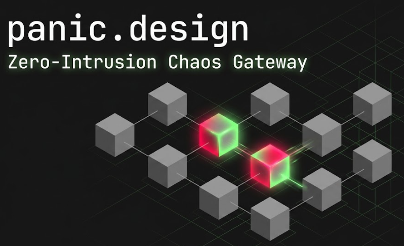

<div align="center">
  
  <h1>panic.design | Zero-Intrusion Chaos Gateway</h1>
  <p>
    <a href="https://github.com/AndrewWangDev/panic_design/blob/main/LICENSE"></a>
    
    
    
    
    
  </p>
</div>

---

## ⚡ Core Features

### 🧠 Intent-Driven AIOps
Say goodbye to tedious YAML configurations. Powered by the logical deduction capabilities of the **Llama 4 Scout 17B (MoE)** model, simply input your intent in natural language (e.g., *"Simulate trans-Pacific cable congestion"*), and our AI Copilot will automatically:
1. Deduce the physical routing trajectory and trigger logical validations (Simulated Routing).
2. Generate deterministic edge chaos injection parameters (Auto-fill Chaos Parameters).
3. Measure and predict the negative impact of these simulated external environment changes on your enterprise Service Level Objectives (SLOs) without executing a real injection.

### ☠️ L4/L7 Mutilation Engine
Achieve true **Zero-Intrusion fault injection** at the Cloudflare edge. Neither clients nor servers need to install any Agent SDKs:
- **L4 Transport Layer Degradation**: Supports precise packet loss, absolute latency (Base Latency), and network jitter (Distributions: Uniform / Normal / Spikes).
- **L7 Application Layer Mutilation**: Supports 429/502/504 status code overwrites, Type Poisoning, Empty Shell responses, and Unexpected EOF truncations.

### 🌍 Global Spatial Sandbox
Powered by our proprietary **LGPA (Localized Geodesic Proximity Algorithm)**, we visualize physical node spatial drift and network degradation trajectories in real-time on a 3D SVG World Map.
By clearly dissecting the latency segments into `T1` (Client to Edge), `T2` (Edge Injection Delay), and `T3` (Edge to Origin), we deliver an intuitive visual animation that puts an end to blind, black-box fault injections.

### 💻 Immersive SRE Console
Features a cyberpunk-style interactive terminal that prints edge interception logs and AI arbitration chain-of-thought processes in real-time. Combined with multi-dimensional quota and usage statistics panels, it enables precise control over the distribution and global, sub-second revocation of JWT Chaos Tokens.

---

## 🏗 Architecture

panic.design utilizes a completely **Control Plane & Data Plane separated**, cloud-native architecture:

```text
[ External Client ]  ◄─────►  [ panic.design Edge Gateway ]  ◄─────►  [ Target Host ]
    (W1 Ingress)                 (Global W2 Proxy Nodes)                (Upstream)
```

- **Control Plane (`new_website`)**:
  Built with the Next.js 16.2 App Router. It manages OAuth authentication, D1 database interactions, Token quotas, generation, and AIOps prompt engineering. The Control Plane uses the Web Crypto API to sign high-security JWTs offline, embedding the fault configurations (Payload) and target coordinates.
- **Data Plane (`new_website_data`)**:
  Built as a pure, stateless reverse proxy using the ultra-lightweight **Hono** framework. Deployed across Cloudflare's 300+ global edge nodes, it performs JWT signature verification and extracts chaos configurations in under 1ms per request. It injects L4/L7 interceptions, mutilations, and delays, then asynchronously writes telemetry logs to SQLite (D1), ensuring zero interference with normal request latency.

---

## 🚀 Getting Started

### Prerequisites
- Node.js (v20+)
- Cloudflare Account & `wrangler` CLI (v4.95+)
- GitHub OAuth App (for Control Plane login)

### Deployment
1. Clone the repository.
2. Configure your `.dev.vars` in the Control Plane (`new_website`) directory (including `AUTH_SECRET`, `GITHUB_ID`, `TURNSTILE_SECRET_KEY`, etc.).
3. Initialize the database using `npx wrangler d1 execute DB --local --file=./prisma/schema.sql`, then run `npm run dev` to start the console.
4. Navigate to the `new_website_data` directory and deploy the edge worker proxy using `wrangler`.

---

## 💥 Zero-Intrusion Demo

The following example demonstrates the extreme transparency of the Data Plane when we inject **Traffic Degradation (Latency)** + **Payload Mutilation (Unexpected EOF)** into HTTP traffic:

```bash
$ export PANIC_TOKEN="eyJhbG...9qu4MA"
$ curl -i "https://gateway.andrewwangdev.com/?token=$PANIC_TOKEN"

HTTP/1.1 200 OK
Date: Tue, 09 Jun 2026 06:14:15 GMT
Content-Type: text/html; charset=UTF-8
Transfer-Encoding: chunked
Connection: keep-alive
CF-Ray: a08dfeb1b9940d77-LAX
CF-Cache-Status: HIT
Age: 45
Cache-Control: public, max-age=43200
Last-Modified: Tue, 09 Jun 2026 01:36:29 GMT
Server: cloudflare
Vary: Origin, Accept-Encoding
Via: 2.0 heroku-router
Access-Control-Allow-Credentials: true
X-Powered-By: Express           <-- [Transparent] The actual framework header of the upstream app
X-Ratelimit-Limit: 1000         <-- [Transparent] The real upstream rate-limiting rules
X-Ratelimit-Remaining: 996
X-Ratelimit-Reset: 1780985615

# ===== panic.design Edge Telemetry Headers Below ===== #
x-panic-colo: LAX               
# [Explanation] The Cloudflare datacenter code where the proxy executed. If running Cloud Injection via Dashboard,
# this represents the Control Plane (W1) colo; if running via a local curl, it represents the Data Plane (W2) colo.

x-panic-t2: 997                 
# [Explanation] The exact latency in milliseconds consumed to execute the chaos injection (Traffic Degradation).

x-panic-t3: 20                  
# [Explanation] The true RTT from the Data Plane to the upstream origin (W3).

x-panic-w1: -118.2437,34.0522   
# [Explanation] The estimated longitude/latitude of the client initiating the request. In the Dashboard, it's the browser's 
# public IP location; locally, it's your local network's public IP location. Used for LGPA algorithm calculations.

x-panic-w3: 0,0                 
# [Explanation] The estimated longitude/latitude of the upstream origin. If you use a local curl, it will always be 0,0.
# Why? Because "Target DNS Resolution + IP Geolocation" is physically and logically decoupled from "Edge Chaos Injection".
# The Control Plane pre-calculates this offline when issuing the Token and embeds it into the JWT to save latency. 
# A pure local curl lacks Dashboard context, so to guarantee zero-intrusion and prevent even 1ms of extra DNS 
# resolution overhead, the Data Plane defaults it to zero.

Strict-Transport-Security: max-age=2592000
Speculation-Rules: "/cdn-cgi/speculation"
alt-svc: h3=":443"; ma=86400

<!DOCTYPE html>
<html lang="en">
  <head>
    <meta charset="utf-8" />
......
<p><strong>Note

... [ERR_TCP_RESET: CONNECTION_DROPPED_BY_PEER] 
# [Explanation] The exact Payload truncation point forcibly generated by the Data Plane based on the Unexpected EOF strategy!

<script>(function(){function c(){var b=a.contentDocument||... // Cloudflare Bot Challenge 
# [Note] The trailing <script> appended after the truncation is the CAPTCHA defense code automatically injected by 
# Cloudflare's external edge infrastructure. It treats our forcibly truncated error message as part of normal HTML. 
# This perfectly proves that our gateway has successfully bypassed the outermost traffic scrubbing mechanisms!
```

---

## 🏆 Notice


Our goal is to explore the ultimate possibilities of Serverless computing and AIOps in next-generation network Chaos Engineering.
**Please DO NOT use this tool for malicious attacks or unauthorized DDoS simulations.** 

### 📄 Legal & Privacy
By using `panic.design`, you acknowledge and agree to our terms.
- **Privacy Policy**: [https://panic.andrewwangdev.com/privacy](https://panic.andrewwangdev.com/privacy)
- **Terms of Service**: [https://panic.andrewwangdev.com/terms](https://panic.andrewwangdev.com/terms)

Built with 🔥 by Andrew Wang Dev
